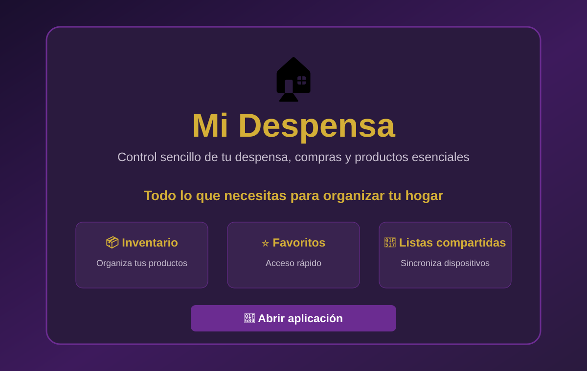
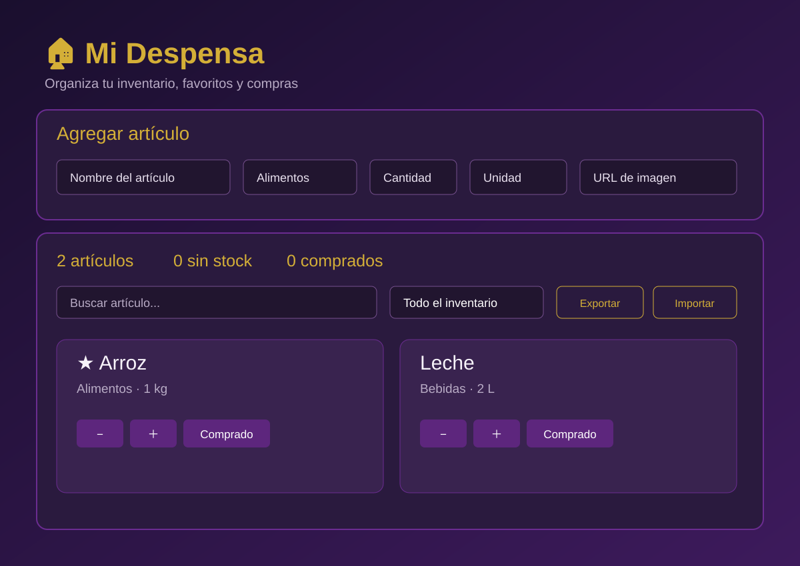
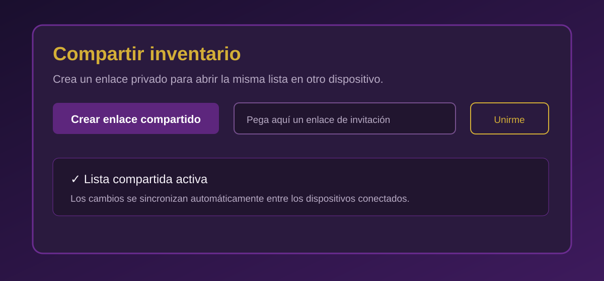

# 🏠 Mi Despensa

Aplicación web para gestionar el inventario del hogar, controlar cantidades y compras, y compartir una lista entre varios dispositivos mediante Supabase.

<p align="center">
  
</p>

## 🚀 Aplicación publicada

**[Abrir Mi Despensa](https://mi-despensa-99yb.onrender.com)**

La aplicación está desplegada como sitio estático en Render.

## ✨ Funcionalidades

- Añadir artículos con nombre, categoría, cantidad y unidad.
- Clasificar productos en categorías domésticas.
- Buscar y filtrar el inventario.
- Marcar favoritos.
- Marcar artículos como comprados y restaurarlos.
- Añadir una URL de imagen a un producto.
- Exportar e importar copias de seguridad JSON.
- Crear enlaces privados para compartir una lista.
- Abrir el enlace desde otro dispositivo para acceder al mismo inventario.
- Sincronizar cambios periódicamente entre dispositivos conectados.

## 🖥️ Capturas y vistas de la interfaz

Las siguientes imágenes son **previsualizaciones ilustrativas de la interfaz**, preparadas para documentar el proyecto. No son capturas tomadas de una sesión real del navegador.

### Página de inicio


### Inventario y gestión de productos



### Compartir inventario



## 🔗 Cómo compartir una lista entre dos dispositivos

1. Abre la [aplicación](https://mi-despensa-99yb.onrender.com).
2. En el apartado **Compartir inventario**, pulsa **Crear enlace compartido**.
3. Copia el enlace privado generado.
4. Abre ese enlace en el segundo dispositivo.
5. Los dos dispositivos accederán a la misma lista. Los cambios se sincronizan automáticamente mediante consultas periódicas.

**Privacidad:** el enlace contiene una clave privada que permite acceder y modificar esa lista. Compártelo únicamente con personas de confianza y evita publicarlo en espacios públicos.

## 🧰 Tecnologías

- HTML5
- CSS3
- JavaScript (cliente)
- [Supabase](https://supabase.com/) para persistencia y funciones RPC de listas compartidas
- [Render](https://render.com/) para el alojamiento estático
- GitHub para el control de versiones

## ⚙️ Configuración de Supabase

La aplicación utiliza el proyecto Supabase configurado para Mi Despensa. Para que la función de compartir esté operativa, la base de datos debe tener:

- Tabla `public.shared_lists`.
- Funciones RPC `create_shared_list`, `get_shared_list` y `save_shared_list`.
- Políticas de acceso que impidan el acceso directo a la tabla; las operaciones se realizan mediante las funciones RPC y una clave privada por lista.

El SQL de configuración se ejecuta desde **Supabase → SQL Editor**. No se debe incluir ninguna clave `service_role` o `secret` en el código del navegador. La clave publishable/anon está diseñada para uso público, siempre que los permisos de base de datos estén correctamente restringidos.

## 📦 Estructura del proyecto

```text
mi-despensa/
├── index.html
├── app.html
├── styles.css
├── README.md
└── docs/
    ├── landing-preview.svg
    ├── inventory-preview.svg
    └── sharing-preview.svg
```

## 🌐 Despliegue

- Plataforma: Render Static Site
- Carpeta publicada: `mi-despensa`
- Rama: `feature/mi-despensa-v2`
- URL: https://mi-despensa-99yb.onrender.com

Los cambios enviados a esta rama activan el despliegue automático de la web.

## 🔐 Datos y almacenamiento

- Sin lista compartida: el inventario se conserva en el almacenamiento local del navegador.
- Con lista compartida: el inventario se guarda en Supabase y se sincroniza entre los dispositivos que utilizan el mismo enlace privado.
- Se recomienda exportar periódicamente una copia JSON como respaldo.

## 📄 Licencia

Proyecto personal. Consulta el repositorio para conocer sus condiciones de uso.
