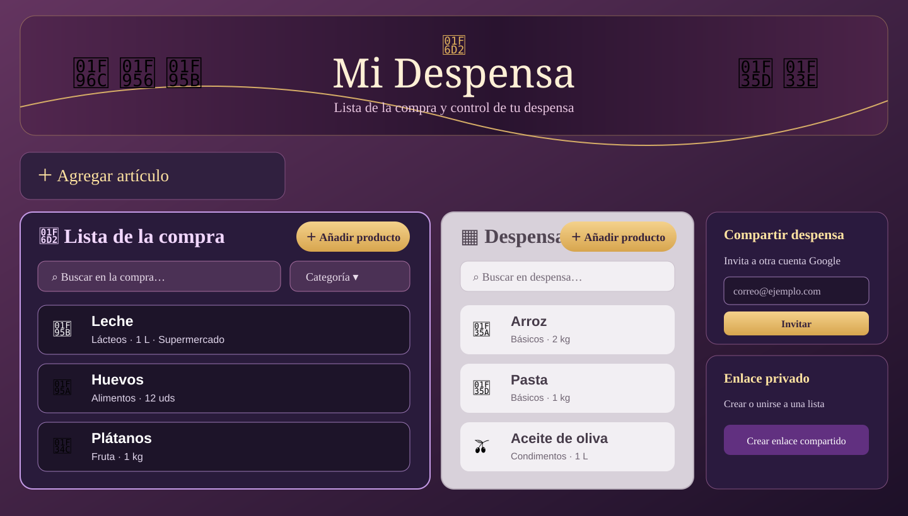
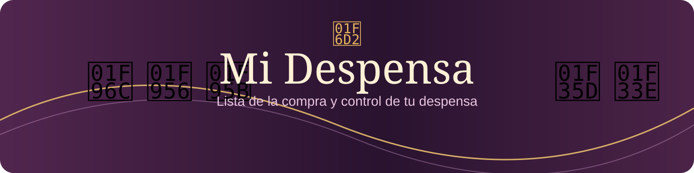

# 🛒 Mi Despensa

Aplicación web para organizar la compra y controlar el inventario de la despensa. Permite gestionar productos, moverlos entre listas, guardar favoritos y sincronizar el inventario entre dispositivos mediante Google y Supabase.

<p align="center">
  <a href="https://mi-despensa-99yb.onrender.com/app.html"><strong>🚀 Abrir Mi Despensa</strong></a>
</p>

## Vista de la aplicación

> Las imágenes de esta sección son **maquetas visuales ilustrativas** preparadas para documentar el diseño. No son capturas de una sesión real ni representan datos reales de una cuenta.

### Panel principal



### Cabecera y estilo visual



## Funcionalidades

- **Lista de la compra:** añade productos que necesitas comprar.
- **Despensa:** conserva los productos que ya tienes en casa.
- **Mover artículos:** marca un producto como comprado para pasarlo a la despensa; cuando se agota, puedes devolverlo a la lista de compra.
- **Edición de productos:** modifica nombre, categoría, cantidad, unidad, tienda e imagen.
- **Búsqueda y filtros:** busca productos por nombre, categoría o tienda y filtra favoritos o artículos sin stock.
- **Favoritos:** marca los artículos que compras habitualmente.
- **Inventario en la nube:** inicia sesión con Google para guardar y sincronizar las despensas.
- **Despensas compartidas:** invita a otra persona por correo; debe iniciar sesión con la misma cuenta Google para aceptar el acceso.
- **Enlace privado heredado:** permite compartir una lista mediante enlace.
- **Copias de seguridad:** exporta e importa el inventario en formato JSON.
- **Diseño adaptable:** interfaz preparada para escritorio y móvil.

### Invitaciones por correo

La aplicación registra la invitación en Supabase asociada al correo indicado. **No envía un correo electrónico automáticamente**: comparte con la otra persona el enlace de la aplicación y pídele que inicie sesión con la cuenta Google invitada.

## Tecnologías

- HTML5, CSS3 y JavaScript.
- [Supabase](https://supabase.com/) — autenticación Google y almacenamiento mediante funciones RPC.
- [Render](https://render.com/) — alojamiento estático.
- Git y GitHub — control de versiones.

## Estructura

```text
mi-despensa/
├── app.html                  # Aplicación principal
├── index.html                # Página de presentación
├── styles.css                # Estilos de la página de presentación
├── supabase-google-auth.sql  # Esquema y funciones de colaboración
├── README.md
└── docs/
    ├── dashboard-preview.svg
    └── header-preview.svg
```

## Puesta en marcha

### 1. Abrir la aplicación

La versión publicada está disponible en:

**https://mi-despensa-99yb.onrender.com/app.html**

### 2. Configurar Supabase

1. Crea un proyecto en Supabase.
2. Ejecuta el contenido de [`supabase-google-auth.sql`](supabase-google-auth.sql) desde **SQL Editor**.
3. Activa Google en **Authentication → Providers** y configura las credenciales OAuth de Google.
4. Añade la URL de la aplicación a las URL de redirección permitidas en Supabase.
5. Comprueba que el proveedor OAuth de Google tenga configurados el origen de la aplicación y el callback de Supabase.

La aplicación utiliza una clave pública *publishable* en el navegador. Nunca incluyas claves `service_role`, secretos OAuth ni credenciales privadas en archivos públicos o en el repositorio.

### 3. Uso local

Al ser una aplicación estática, puedes abrir `app.html` desde un servidor web local. Para utilizar inicio de sesión y sincronización, configura previamente Supabase y las URL de redirección correspondientes.

## Datos y privacidad

- Sin iniciar sesión, los datos se conservan en el almacenamiento local del navegador.
- Con Google, el inventario se guarda en la despensa de Supabase a la que pertenece la cuenta.
- Las operaciones de colaboración se realizan mediante funciones RPC con comprobación de pertenencia.
- Los enlaces privados heredados deben tratarse como credenciales: cualquier persona que los posea puede acceder a la lista asociada.
- Exporta periódicamente una copia JSON si necesitas una copia independiente.

## Despliegue

- **Servicio:** Render Static Site.
- **Directorio publicado:** `mi-despensa`.
- **Rama de trabajo:** `feature/mi-despensa-v2`.
- **URL:** https://mi-despensa-99yb.onrender.com

Los cambios enviados a la rama conectada pueden iniciar un despliegue automático en Render.

## Estado de la documentación

Las vistas incluidas son maquetas de referencia. Para añadir capturas fieles de la versión publicada, abre la aplicación desplegada con datos de prueba y sustituye las imágenes SVG de `docs/` por capturas reales de escritorio y móvil.

## Licencia

Proyecto personal. Consulta el repositorio para conocer las condiciones de uso.
